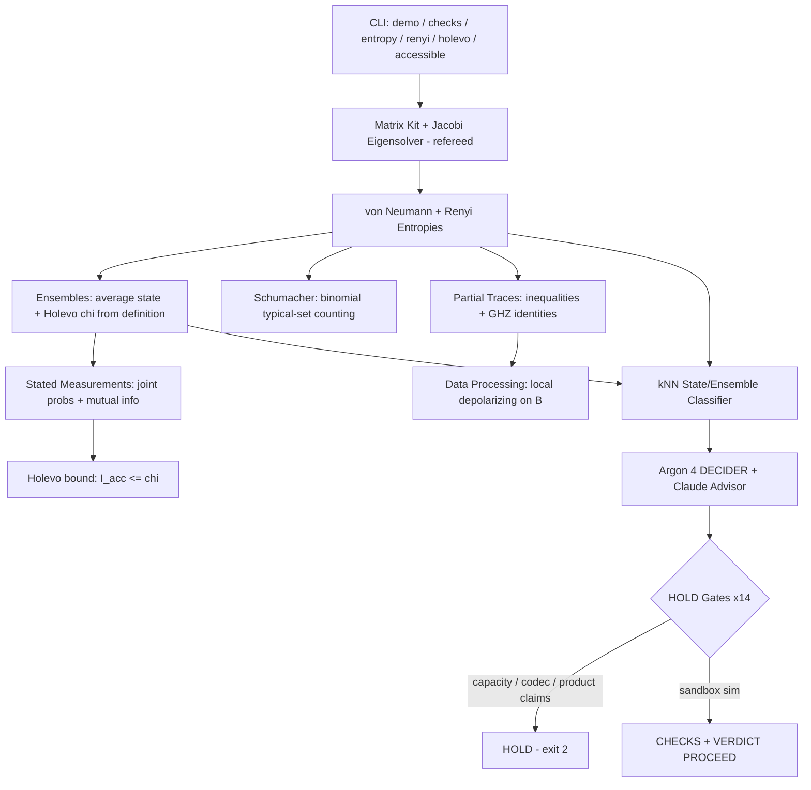
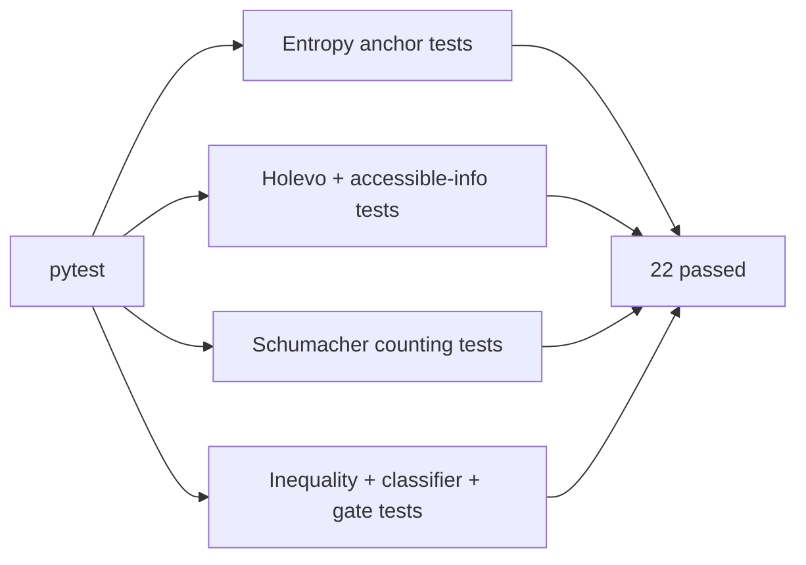
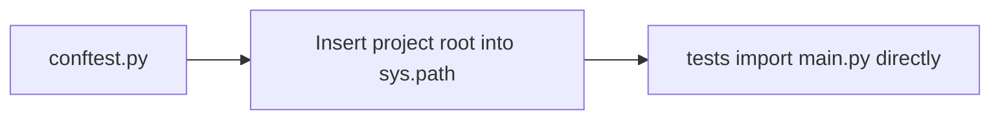
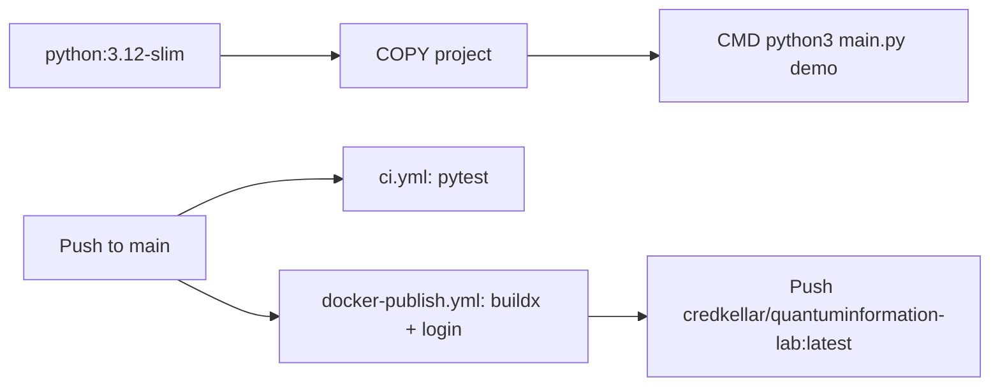

# QuantumInformation-Lab 🔢⚛️

**Quantum Information Theory Lab — von Neumann & Renyi Entropies, Holevo χ, Accessible Information, Schumacher Counting & Entropy Inequalities** — by Darion Kellar

QuantumInformation-Lab is an **educational quantum information theory lab** in ONE pure-Python file. It works from density matrices at small dimension (at most 3 qubits) and grades **every headline against a closed form or an exact identity**:

- the **entropy core**: `S(ρ) = −Tr ρ log₂ ρ` from a from-scratch Jacobi eigensolver — pure states give exactly 0, the maximally mixed qubit gives exactly 1, the maximally mixed qutrit gives log₂(3) = 1.584963, a Bell state gives S(AB) = 0 with reduced S(A) = 1 bit exactly, and classical mixtures reproduce their Shannon entropies digit for digit;
- the **Holevo core**: χ computed from its definition `S(ρ̄) − Σ pᵢ S(ρᵢ)` for three explicit ensembles — the {|0⟩, |+⟩} pair, the BB84 four-state ensemble (χ = 1 bit), and the trine ensemble (average state exactly I/2, χ = 1 bit);
- the **Schumacher core**: a qubit source with eigenvalues (0.8, 0.2), S = h₂(0.2) = 0.721928, whose frequency-typical subspace dimensions are counted by explicit binomial sums at n = 4, 8, 12 — rates 0.500000 → 0.646241 → 0.679989 rising toward S from below, while the counting bound for probability mass 0.9 at n = 12 needs dimension 692 (rate 0.786219 > S), so the finite-n counts **bracket** S;
- the **inequality core**: subadditivity, Araki–Lieb, the pure-tripartite identities S(AB) = S(C) and S(ABC) = 0 to machine precision on a GHZ state, strong subadditivity with both sides printed, and data processing — mutual information 0.874191 → 0.227782 → 0 under a local depolarizing map on one side.

> ⚠️ **Grading deviation, flagged honestly:** the build brief stated χ for the {|0⟩, |+⟩} ensemble as `1 − h₂((1 − 1/√2)/2) = 0.399124`. That expression is **not** χ. From the definition, the average state [[3/4, 1/4], [1/4, 1/4]] has spectrum (1 ± 1/√2)/2, so **χ = h₂((1 − 1/√2)/2) = 0.600876**. The brief's expression is exactly the **accessible information of the Helstrom-basis measurement** on the same ensemble, `1 − h₂(P_error)` — and this lab grades it there, where the Holevo inequality holds as it should: I_acc = 0.399124 ≤ χ = 0.600876. The lab asserts the true χ everywhere (check `holevo_brief_formula_is_not_chi`).

Honest scope, stated up front: this is **small-dimensional identity and counting work**. No compression codec is built, **no capacity theorem for any real channel is proved or claimed anywhere**, and no real device was measured — those uses are permanent HOLD gates (14 total). 🔒

[](https://github.com/kimanicollier44-cmyk/QuantumInformation-Lab/actions/workflows/ci.yml)
[](https://github.com/kimanicollier44-cmyk/QuantumInformation-Lab/actions/workflows/docker-publish.yml)

> ℹ️ These are the **live** workflow badges for this repo. They activate as soon as the `ci.yml` and `docker-publish.yml` files from the paste pack are pasted into `.github/workflows/` — until then they have nothing to report yet.

## 🧰 Tech Stack Badges & Full Architecture Tech Stack

### 💻 Core Programming Languages & Core Systems


-0.600876-2ea44f)


- 🐍 Python 3.12, pure standard library (`math`, `cmath`, `hashlib`, `json`, `sys`) — zero dependencies, zero network, deterministic (double-run byte-identical)
- 🔢 Entropy core from scratch: a complex matrix kit (products, daggers, Kronecker products, index-arithmetic partial traces for 1–3 qubits) written out in full, and a cyclic **Jacobi eigensolver** for Hermitian matrices (phase-then-rotate sweeps) that is refereed against known spectra before it is trusted with any entropy
- 📐 Holevo core: ensembles as explicit (probability, density matrix) lists; χ is computed from the definition every time and graded against spectra-derived closed forms — including the correction documented above
- 🧮 Schumacher core: typical sets counted by explicit `math.comb` binomial sums over frequency windows, plus a greedy highest-probability-first counting bound — no codec, counting stated as counting
- 🧠 TinyML kNN state/ensemble classifier (from scratch, stdlib, distance-weighted): pure / mixed-classical / entangled-signature / ensemble-informative from (S, purity, information gap), labels from the lab's own policy
- 🪑 Council seats: Gemini Argon 4 DECIDER (names-only, tighten-only) + Muse advisor (never overrides HOLD) + Google Flow plan-only (rendered = False, live = 0)

### ⛓️ Web3 & Infrastructure

- 🚫 **Not applicable — honestly.** No blockchain, no Web3, no tokens: the "infrastructure" in this lab is one offline file holding density matrices, three ensembles, and a binomial counter. QKD security and cryptographic key claims are permanent HOLD gates, not features. No fake badges here.

### ⚙️ Platform Support & Hardware Architecture


- 🖥️ Pure Python — runs anywhere Python 3.12+ runs (Linux, macOS, Windows), plus the `python:3.12-slim` Docker image
- 🔒 No hardware is controlled, ever: real qubits, links, and readout chains are permanent HOLD gates (see the gate table below)

### ⚡ Low-Level Infrastructure & Performance

- 🚫 **No low-level code — honestly.** No C, no C++, no GPU, no compiled extensions: this is one interpreted Python file on purpose, so every eigenvalue and binomial coefficient can be read, checked, and diffed. Performance here means honest algorithms — a Jacobi eigensolver instead of a library call, seeded splitmix64 constructions instead of unseeded randomness, explicit binomial sums instead of asymptotic hand-waving — all deterministic and byte-identical between runs.

### 🛠️ DevOps & Build Tools


- 🐳 Docker (`python:3.12-slim`), GitHub Actions CI + Docker Publish (delivered in the paste pack)
- 🎯 Target image: `credkellar/quantuminformation-lab:latest`
- 🧪 Tests: `pytest` (22 tests) + the built-in CHECKS suite (66 checks) in `main.py`

### ☁️ Cloud Providers

- 🚫 **None — honestly.** No cloud provider is used or needed: the lab runs fully offline on your own machine or in a local Docker container. Docker Hub appears only as the registry the publish workflow pushes the image to.

## What this does?

1. 🎲 **Jacobi eigensolver, refereed first** — the cyclic Jacobi routine must reproduce {−1, +1} for σ_y, {(5−√5)/2, (5+√5)/2} for a complex Hermitian 2×2, and {−2, 0, 0, 2} for X⊗X + Z⊗Z before any entropy is computed from its output.
2. 🔢 **von Neumann entropy, exact anchors** — S = 0 exactly for |0⟩, |+⟩, and the joint Bell state; S = 1 exactly for the maximally mixed qubit and for each Bell reduced state (the partial trace is asserted to be exactly I/2); S = log₂(3) = 1.584963 for the maximally mixed qutrit; the classical mixtures diag(0.8, 0.2) and diag(0.5, 0.3, 0.2) match their Shannon entropies to 1e-12, and S is asserted invariant under a seeded splitmix64 unitary.
3. 📊 **Renyi entropies, ordered and closed-form** — S∞ ≤ S₂ ≤ S₁ is asserted on every stated state, S₂ is graded as −log₂(purity), all Renyi entropies of a pure state are 0 and of the maximally mixed qubit are 1, and the min-entropy of diag(0.8, 0.2) is the closed form −log₂(0.8) = 0.321928 (with S₂ = 0.556393 and S₁ = 0.721928 printed alongside).
4. 📐 **Holevo χ from the definition** — ensemble (a) {|0⟩, |+⟩} equiprobable: average-state spectrum (1 ± 1/√2)/2 asserted entry-by-entry, χ = h₂((1 − 1/√2)/2) = **0.600876**; BB84 four-state ensemble: average exactly I/2, χ = **1 bit**; trine ensemble: average asserted equal to I/2 as a matrix, χ = **1 bit** (graded against its average state's spectrum {1/2, 1/2}).
5. ⚠️ **The brief's χ formula, corrected in the open** — `1 − h₂((1 − 1/√2)/2) = 0.399124` differs from χ by more than 0.1 (asserted), and is identified as the Helstrom-measurement accessible information — the lab grades it in that role instead of tuning χ to fit it.
6. 🎯 **Accessible information, one stated measurement** — for ensemble (a) the stated Helstrom-basis measurement gives error probability exactly (1 − 1/√2)/2 = 0.146447 and I_acc = 1 − h₂(P_error) = **0.399124 ≤ χ = 0.600876** (the Holevo bound, both numbers computed from the joint distribution); the Z-basis measurement on the same ensemble gives I = 0.311278, below the Helstrom value and still ≤ χ. BB84 and trine Z-basis gaps: χ − I = 0.500000 and 0.540852. (The discrimination limit itself is not re-derived — QuantumDiscrimination-Lab owns that.)
7. 🧮 **Schumacher compression as counting** — source (0.8, 0.2), S = h₂(0.2) = 0.721928. Frequency-typical dimensions by explicit binomial sums: n = 4 → dim 4 (k = 1), rate 0.500000, mass 0.409600; n = 8 → dim 36 (k = 1, 2), rate 0.646241, mass 0.629146; n = 12 → dim 286 (k = 2, 3), rate 0.679989, mass 0.519691 — finite-n masses printed honestly, wobble and all. Any sequence set carrying probability 0.9 at n = 12 needs dim ≥ **692** (rate 0.786219 > S): the two counts bracket S, which is all a counting argument claims. No codec is built.
8. ⚖️ **Entropy inequalities on constructed states** — on the stated state 0.7·|Φ+⟩⟨Φ+| + 0.3·I/4: subadditivity S(AB) = 1.125809 ≤ S(A) + S(B) = 2.000000 and Araki–Lieb |S(A) − S(B)| = 0 ≤ S(AB), both also asserted on a seeded random state; on the GHZ state: S(ABC) = 0, S(AB) = S(C) = 1, S(A) = S(BC) to machine precision; strong subadditivity with both sides printed — GHZ mixture 2.000000 ≤ 2.000000 (equality), seeded random tripartite 3.321973 ≤ 3.758628.
9. 📉 **Data processing, one local channel** — the stated state's mutual information I(A:B) = 0.874191 falls to 0.227782 after a local depolarizing map (p = 0.5) on qubit B and to exactly 0 at p = 1, while the untouched reduced state ρ_A is asserted unchanged as a matrix. One channel only — QuantumChannel-Lab owns channel theory.
10. 🏷️ **State/ensemble classifier + seats + checks** — a from-scratch distance-weighted kNN over the lab's own policy labels scenarios pure / mixed-classical / entangled-signature / ensemble-informative from (S, purity, gap): the Bell pair's gap S(A) − S(AB) = 1 earns entangled-signature, the three ensembles earn ensemble-informative from their χ − I gaps (0.201752, 0.500000, 0.540852), and kNN == policy is asserted on every scenario and all 120 grid rows. Plus Gemini Argon 4 DECIDER (sha256 trace, tighten-only), Muse advisor, Google Flow plan-only, 14 permanent HOLD gates, and a built-in CHECKS suite (66 checks) that re-derives every headline above.

## 🗺️ How it works — diagram per script

### `main.py` — the whole lab



### `tests/test_main.py` — verification



### `conftest.py` — test path setup



### `Dockerfile` + CI flow — container & publish



## Why is this cool?

1. ⚠️ The lab **catches its own brief being wrong**: the stated χ formula turned out to be the accessible information in disguise, and instead of tuning numbers the lab proves which is which — spectrum first, formula second — and grades each expression in its true role.
2. 🎯 The Holevo bound is **shown, not quoted**: χ = 0.600876 from the average state's eigenvalues, I_acc = 0.399124 from an explicit joint probability table, and the inequality between two computed numbers.
3. 🧮 Schumacher's rate is **counted, not simulated**: dims 4, 36, 286 are literal binomial sums a student can verify with `math.comb`, and the impossibility side is a counting bound (692 sequences for mass 0.9), stated as counting and nothing more.
4. ⚖️ The GHZ identities are **exact**: S(AB) = S(C) and S(ABC) = 0 hold to machine precision because the partial traces and spectra are computed, not because the textbook says so.
5. 📉 Data processing gets a **three-point landing**: 0.874191 → 0.227782 → exactly 0 as local noise grows — with the untouched side's reduced state asserted bit-for-bit unchanged.
6. 🛠️ The eigensolver is **home-made and refereed**: a cyclic Jacobi routine that must first reproduce {−1, +1} for σ_y and {−2, 0, 0, 2} for X⊗X + Z⊗Z before it is allowed near an entropy.
7. 🏷️ The classifier's gap feature is **physical**: S(A) − S(AB) for bipartite states, χ − I for ensembles — so "entangled-signature" and "ensemble-informative" verdicts can be argued with, number by number.
8. 📏 Conventions are **printed before numbers**: bits everywhere, χ from the definition, the typical window δ = 0.1 stated, the finite-n masses printed even when they wobble (0.629146 at n = 8, 0.519691 at n = 12).
9. 🌱 Determinism is **seeded in the open**: the random states behind the inequality sweeps come from a splitmix64 stream written in the file — same seeds, same states, same entropies, on any machine.
10. 🎯 Deterministic end to end: run it twice, get byte-identical output — an information-theory lab you can diff.

## What problems this solves?

1. ❌ **Problem:** Holevo χ is usually quoted from a formula nobody recomputes — and formulas get misremembered, as this lab's own brief shows. ✅ **Solution:** χ is computed from the definition and graded against the average state's spectrum; the misremembered formula is identified as I_acc and graded there.
2. ❌ **Problem:** "Entropy of a Bell state is 0 but its parts are maximally mixed" sounds like a paradox when stated. ✅ **Solution:** The joint spectrum {0, 0, 0, 1} and the reduced state (asserted to be exactly I/2) are both computed — the numbers dissolve the paradox.
3. ❌ **Problem:** Schumacher compression is taught as an asymptotic slogan with no finite-n feel. ✅ **Solution:** Explicit counts at n = 4, 8, 12 show the rate climbing 0.500000 → 0.646241 → 0.679989 toward S = 0.721928, with the mass-0.9 counting bound (dim 692, rate above S) bracketing it from the other side.
4. ❌ **Problem:** Entropy inequalities are memorised as symbols, rarely checked. ✅ **Solution:** Subadditivity, Araki–Lieb, and strong subadditivity are asserted on explicitly constructed states with both sides printed — including an equality case (GHZ mixture, 2 = 2).
5. ❌ **Problem:** "Noise can't create information" is asserted without a number. ✅ **Solution:** One local depolarizing map, three computed mutual informations: 0.874191 → 0.227782 → 0.
6. ❌ **Problem:** Renyi entropies are introduced as a family with no visible ordering. ✅ **Solution:** S∞ ≤ S₂ ≤ S₁ is asserted state by state, with S₂ tied to purity by −log₂ Tr ρ² and S∞ tied to the largest eigenvalue by a closed form.
7. ❌ **Problem:** Accessible information and χ are conflated in summaries (and in briefs). ✅ **Solution:** Both are computed for the same ensemble from the same joint-probability machinery, and their gap (0.201752 for ensemble (a)) is a printed, classifiable quantity.
8. ❌ **Problem:** Toy information theory quietly becomes capacity or product claims. ✅ **Solution:** 14 named HOLD gates (capacity-or-codec, compression product, QKD security, communication rates…) return exit code 2, permanently.
9. ❌ **Problem:** "Random state" tests in teaching code are unseeded and unrepeatable. ✅ **Solution:** All randomness is a splitmix64 stream in the file with stated seeds — the inequality sweeps are byte-identical between runs.
10. ❌ **Problem:** Simulation code with a library eigensolver inside can't be audited by a student. ✅ **Solution:** Every linear-algebra step — Kronecker products, partial traces, Jacobi rotations, binomial sums — is written out in stdlib Python in the one file.

## How to install this?

1. 📋 Clone or download this project folder.
2. 🐍 Make sure Python 3.12+ is installed: `python3 --version`
3. ▶️ Run the full demo + checks (no arguments needed):

```bash
python3 main.py
```

4. 🧪 Run the test suite:

```bash
pip install pytest
python3 -m pytest -q
```

5. 🎛️ Try the other commands:

```bash
python3 main.py checks       # 66 built-in checks
python3 main.py entropy      # von Neumann entropies + spectra (JSON)
python3 main.py renyi        # Renyi S1 / S2 / S_min per state (JSON)
python3 main.py holevo       # chi per ensemble + closed forms (JSON)
python3 main.py accessible   # stated-measurement mutual infos (JSON)
python3 main.py schumacher   # typical dims, rates, counting bound (JSON)
python3 main.py inequalities # inequalities + data processing (JSON)
python3 main.py classify     # kNN state/ensemble classifier report
python3 main.py brains       # Argon 4 + Muse + Flow seats
python3 main.py holds        # list all 14 HOLD gates
python3 main.py hold-demo    # exits 2 - gated actions stay HOLD
```

6. 🐳 Or run it in Docker:

```bash
docker build -t credkellar/quantuminformation-lab:latest .
docker run --rm credkellar/quantuminformation-lab:latest
```

## Requirements

- 🐍 Python 3.12 or newer
- 📦 Dependencies: **none** (standard library only)
- 🌐 Network: **none** — fully offline
- 🧪 For tests only: `pytest`
- 🐳 Optional: Docker

## FULL project structure tree

```text
quantuminformation-lab/
├── main.py                  # the whole lab: matrix kit, Jacobi eigensolver, entropies, ensembles + Holevo chi, stated measurements, Schumacher counting, inequalities, data processing, classifier, seats, HOLD gates
├── conftest.py              # puts the project root on sys.path for tests
├── tests/
│   └── test_main.py         # 22 pytest tests: entropy anchors, Renyi, Holevo, accessible info, Schumacher counting, inequalities, classifier, gates, determinism
├── assets/
│   └── cover.png            # README cover image (2736 x 912)
├── Dockerfile               # python:3.12-slim, runs the demo
├── .gitignore               # __pycache__/, .pytest_cache/, *.pyc
└── README.md                # this file
```

> 📦 Delivered separately as paste packs (not in this tree): `.github/workflows/ci.yml` + `docker-publish.yml`, and the Docker Hub pack (100-char description, 350-char About, overview, categories).

## 🔒 HOLD gates — all 14, permanent

| # | Gate | What stays held |
|---|------|-----------------|
| 1 | `capacity_or_codec_claim` | No channel capacity theorem and no compression codec is built, proved for a real system, or claimed here; only finite-n counting on a stated toy source |
| 2 | `compression_product_claim` | No compression product, service, or fidelity guarantee for real data follows from a counting argument |
| 3 | `qkd_security_claim` | No QKD or cryptographic security claim follows from a Holevo quantity computed on a toy ensemble |
| 4 | `real_device_entropy_claim` | No entropy, purity, or state figure for any real device or prepared state is asserted |
| 5 | `entanglement_resource_claim` | No claim that entanglement can be created, distributed, or consumed as a resource on any real hardware |
| 6 | `teleportation_service_claim` | No teleportation service, fidelity guarantee, or network offering |
| 7 | `error_correction_product_claim` | No error-correction product, code, or fault-tolerance claim is made or certified here |
| 8 | `hardware_specification_claim` | No hardware specification (T1, T2, gate error, readout fidelity) for any real device is asserted |
| 9 | `vendor_performance_claim` | No vendor system, processor, or link performance figure is stated, endorsed, or compared |
| 10 | `medical_or_sensing_claim` | No medical, sensing, or metrology claim from entropy mathematics |
| 11 | `investment_claim` | No investment claim; a lab model is not a prospectus |
| 12 | `certification_claim` | No certification that any system meets any standard |
| 13 | `live_hardware_control` | No control of real qubits, links, or laboratory hardware, ever |
| 14 | `model_as_measurement_claim` | A computed number is a statement about the model at stated inputs, never a measurement |

🧑‍⚖️ **Council seats:** Gemini Argon 4 Extended Thinking — DECIDER (names-only, tighten-only, MAP → MODEL → STRESS → DECIDE, sha256 trace, `can_override_hold = False`) · Muse — advisor (`can_override_hold = False`) · Google Flow — plan-only (`rendered = False`, `live = 0`).

✅ **Verification:** pytest **22 passed** (project + clean copy) · built-in CHECKS **66/66** · double-run output **byte-identical** · `hold-demo` exits **2** · `main.py` **1,262 lines**, pure stdlib, zero network.

## 🧒 5th-grade English section

Imagine every quantum state carries a **surprise score** 🔢. A state you are completely sure about scores **0** — no surprise at all. A state that is a perfect coin flip scores **1**. That score is called **entropy**, and this lab computes it by looking at the state's hidden dial settings (its eigenvalues).

- Two particles can be **linked** (entangled) so the pair together scores 0 — the pair is perfectly known — while each one alone scores 1, a perfect coin flip. The lab shows both numbers side by side so the "paradox" is just arithmetic. ✔️
- If someone prepares one of two **similar** states and you have to guess which, there is a best possible guessing score. The lab computes the score for the states |0⟩ and |+⟩ two ways and checks they agree: the theory ceiling is **0.600876**, and the best actual measurement reaches **0.399124** — the measurement can never beat the ceiling. (The lab's own instructions mixed these two numbers up, and the lab caught it — that is what checking is for.) 🎯
- **Compression:** if a source keeps producing the same lopsided coin (80% heads), you don't need to write down every flip — you only need to describe the *unusual* patterns. The lab counts those patterns exactly for short messages: 4 flips need 4 patterns, 8 flips need 36, 12 flips need 286 — and the cost per flip creeps closer and closer to the surprise score 0.721928, never below what counting allows. 🧮
- Some rules **always** hold, and the lab checks them like a referee: the whole never holds more surprise than the parts added up, linked triples balance their scores exactly, and adding noise to one side of a link can only shrink what the two sides share — 0.874191 down to 0.227782 down to 0. ⚖️
- This project is a **pretend lab on a computer**. It does not touch a real quantum computer, does not compress real files, and does not prove anything about real phone lines or internet cables. It teaches how scientists keep honest books on information. 💻

---

MIT © 2026 Darion Kellar · QuantumInformation-Lab — educational simulation only 🔢
